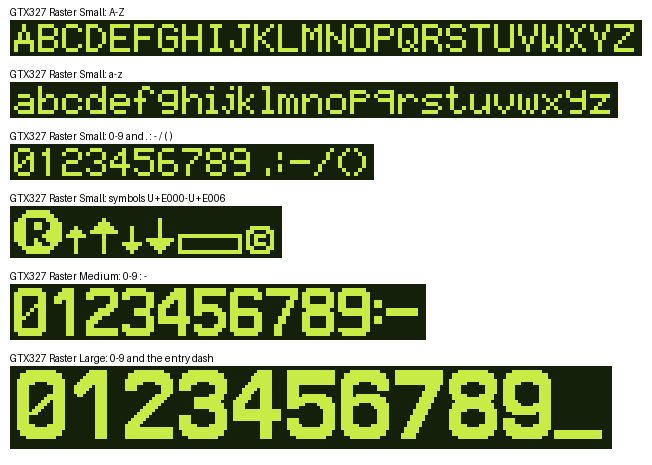

# GTX 327 LCD raster fonts

Dot-matrix fonts for a Garmin GTX 327 style 200 x 33 dot LCD, made for the
X-Plane GTX 327 avionics package. They are pixel fonts: every visible dot is a
square, and nothing is meant to be smoothed or anti-aliased.

| File | Height | Advance | Use |
|---|---|---|---|
| `GTX327RasterSmall-Regular.ttf` | 7 rows | 6 (see below) | labels, titles, mode and IDENT text |
| `GTX327RasterMedium-Regular.ttf` | 12 rows | 9 for digits and `-`, 3 for the colon, 5 for the space | altitude and HH:MM:SS timer values |
| `GTX327RasterLarge-Regular.ttf` | 27-row cell | 18 | the four-digit squawk code |

**Small font**
- Advance 6 for A-Z, a-z and 0-9, except `i j l ( )` 4. `. :` and space
  advance 3.
- Lowercase sits on the baseline, with no descenders.
- Private-use symbols:

| Code point | Symbol |
|---|---|
| U+E000 | reply annunciator (circled R, 11 rows) |
| U+E001 | small up trend arrow |
| U+E002 | large up trend arrow (9 rows) |
| U+E003 | small down trend arrow |
| U+E004 | large down trend arrow (9 rows) |
| U+E005 | bar outline |
| U+E006 | copyright sign |

**Large font**
- The digits sit in a 27-row cell. Every digit is 23 rows tall.
- `-` is the low entry dash shown while a code is being typed.

## Grid

- 100 font units = 1 LCD dot. Every contour is an axis-aligned rectangle on
  that grid.
- To use the fonts as bitmaps, sample each dot at its centre, or render at
  exactly 1 dot = 1 pixel (or an integer multiple) with anti-aliasing off.
- To edit, keep contours rectangular and snapped to multiples of 100 units.

## Fidelity

The following glyphs were checked dot for dot against Garmin's own LCD
figures: the 200 x 33 display bitmaps in the GTX 327 Installation Manual
(190-00187-02 Rev N) and the Pilot's Guide (190-00187-00 Rev D) figures.

- **Small:** A B C D E F H I K L M N O P Q R S T U V Y 0 1 2 3 4 5 8, the space
  width, and the monospaced I.
- **Medium:** 0 1 2 3 5 6, the colon, and its spacing.
- **Large:** 1 3 4 5 7.

Garmin's large digits are its medium design drawn bigger; the 3 and 5, exact
at both sizes, confirm this. So the large 0, 2 and 6 follow Garmin's exact
medium 0, 2 and 6, built from parts of the exact large 3, 4, 5 and 7. The large 8 and 9 have no Garmin
source at any size; 8 is the 3 made symmetric and 9 is the 6 turned 180
degrees. The remaining glyphs follow the same style but have no exact Garmin
source.

The real unit also draws a few annunciators (for example ALT and FL) and its
installer configuration values in bold faces. This set deliberately uses one
face for all text.

Garmin and GTX are trademarks of Garmin Ltd. or its subsidiaries. These fonts
are an independent recreation and are not affiliated with or endorsed by
Garmin.
